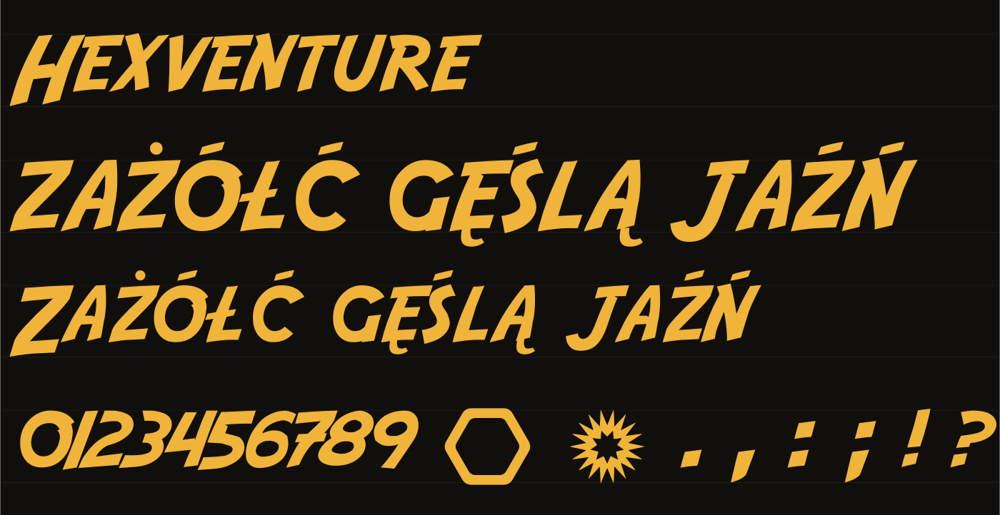

# Hexventure

A brush-lettered display font with full **Polish** support – the title font of
[HexBattle Online](https://hexbattle.online), shared with everyone under the SIL Open Font License.



Hexventure is a modified version of **Adventure** by **Neale Davidson** (Pixel Sagas). It adds:

- **Polish letters** – Ą Ć Ę Ł Ń Ó Ś Ź Ż and ą ć ę ł ń ó ś ź ż, drawn in the font's brush style;
- **Z and z without the crossbar**;
- **even spacing** – no two letters touch, and digits are kerned to the same gap;
- **punctuation on the lowercase line** – the lowercase letters are smaller capitals that hang from the cap line,
  and . , : ; … ! ? sit with them;
- a **hexagon** on the "#" key and the **Bitwa** icon of Neuroshima Hex on the "@" key.

## Files

| File | Use |
| --- | --- |
| `fonts/Hexventure-Regular.woff2` | websites (smallest) |
| `fonts/Hexventure-Regular.woff` | websites, older browsers |
| `fonts/Hexventure-Regular.ttf` | desktop, design tools |

## Use on a website

```css
@font-face {
	font-family: 'Hexventure';
	font-style: normal;
	font-weight: 400;
	font-display: swap;
	src:
		url('fonts/Hexventure-Regular.woff2') format('woff2'),
		url('fonts/Hexventure-Regular.woff') format('woff');
}

h1 {
	font-family: 'Hexventure', Impact, sans-serif;
}
```

Character set: Basic Latin, Latin-1 and the Polish letters.

## Licence

Hexventure is licensed under the **SIL Open Font License 1.1** – see [OFL.txt](OFL.txt). You may use it in any
project, personal or commercial, embed it, modify it and share it. You may not sell the font on its own, and a
modified version must keep this licence and use a different name.

The Bitwa icon on "@" is © Portal Games (Neuroshima Hex), it is not covered by the Open
Font License.

## Credits

- **Adventure** – original design © 2011–2014 Neale Davidson (Pixel Sagas).
- **Hexventure** – modifications © 2026 HexBattle Online, by Kazdaniarz.
- **Bitwa icon** ("@") – © Portal Games, Neuroshima Hex.
